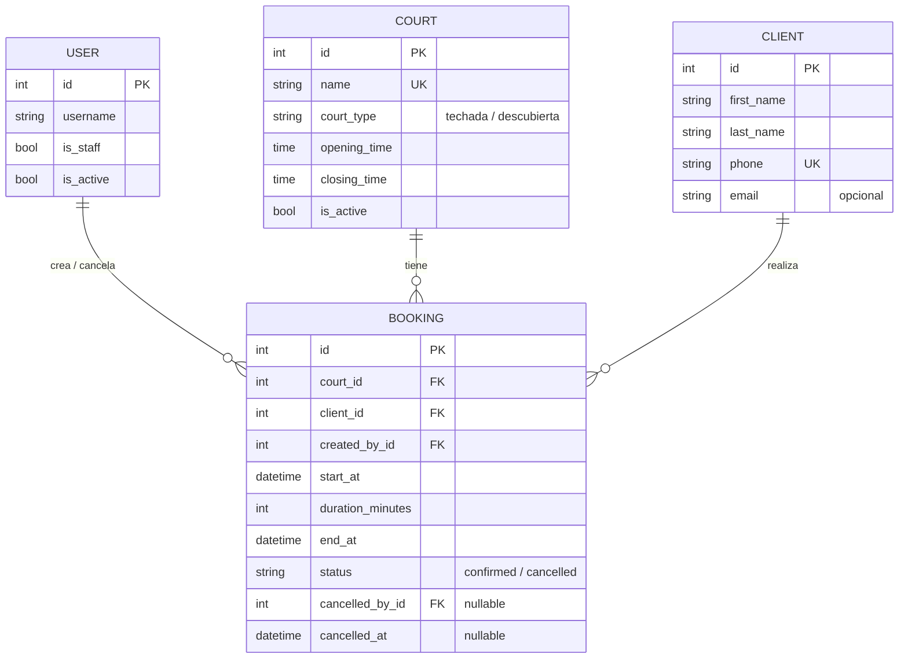

# Modelo de datos — Total Control

Hay cuatro entidades. La central es la **reserva**: une una cancha con un cliente y guarda qué usuario la creó y quién la canceló.

La imagen del DER está en `docs/tfi/diagramas/der.png`.

## Detalles que vale la pena aclarar

- No se pueden borrar canchas ni clientes que tengan reservas (`PROTECT`).
- El teléfono del cliente es único. Lo guardamos solo con números, así el mismo cliente no queda cargado dos veces.
- Si se reserva para alguien nuevo, el cliente se crea en el mismo paso, buscándolo por teléfono.
- Guardamos `end_at` calculado. Una restricción de PostgreSQL (`ExclusionConstraint`, con `btree_gist`) impide que dos reservas confirmadas se pisen en la misma cancha.
