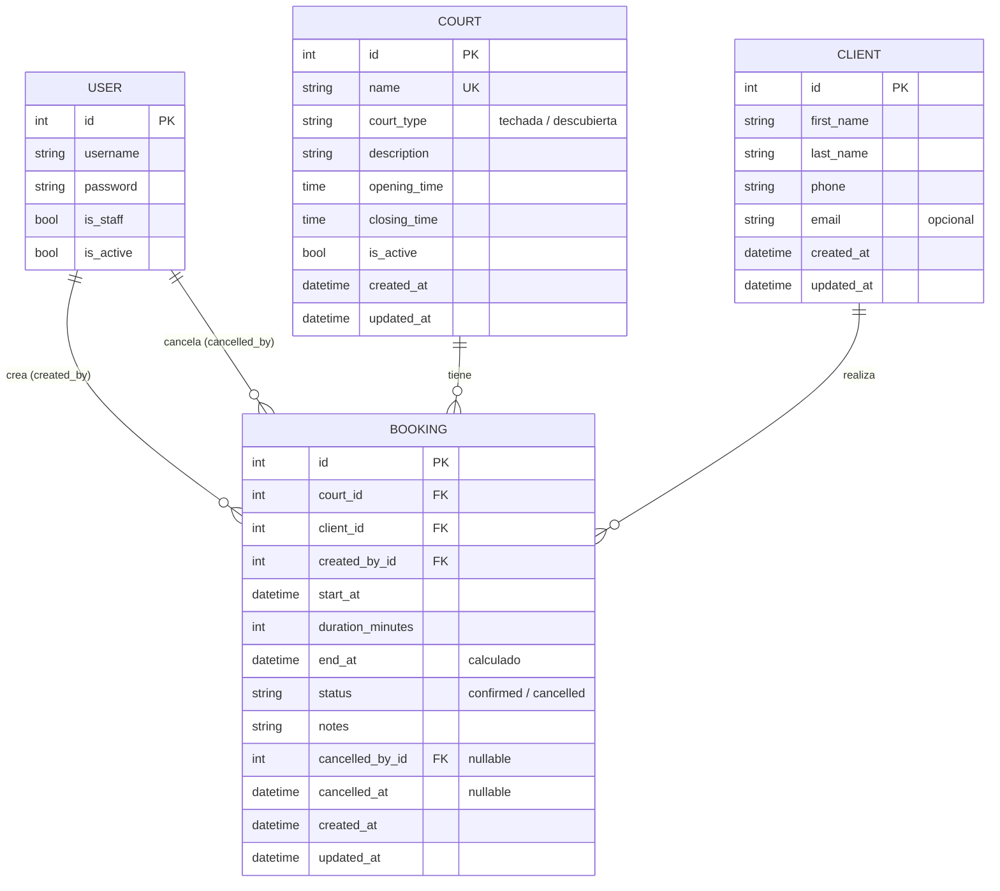

# Modelo de datos — Total Control

## Diagrama entidad-relación

## Relaciones
- **Court 1—N Booking**: una cancha tiene muchas reservas (`on_delete=PROTECT`).
- **Client 1—N Booking**: un cliente puede tener muchas reservas (`PROTECT`).
- **User 1—N Booking**: auditoría de quién creó (`created_by`) y quién canceló (`cancelled_by`, con `cancelled_at`) la reserva (`SET_NULL`).
- Cliente se registra dentro del flujo de reserva: se busca por teléfono y, si no existe, se crea (`get_or_create` en el servicio).

## Restricciones
- `Court.name` único.
- `Court`: `opening_time < closing_time`.
- `Client.phone` único, normalizado (solo dígitos y `+` inicial).
- `Booking`: `duration_minutes` > 0 y `end_at > start_at` (CheckConstraints); el múltiplo de 30 y el máximo se validan en el servicio (RN4). `end_at` se persiste.
- `Booking`: `ExclusionConstraint` PostgreSQL: no hay dos filas con la misma `court` y rangos `[start_at, end_at)` solapados cuando `status='confirmed'` (requiere extensión `btree_gist`).
- Índices: `(court, start_at)`, `start_at`.
